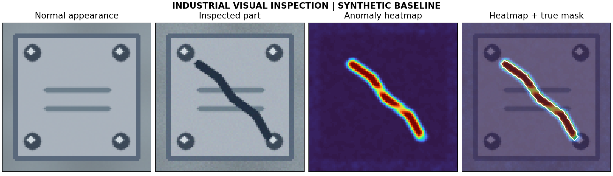

# Industrial visual inspection

**Hazem Nefzi · Robotics / AI / Computer Vision · v2.0**

Aligned-reference inspection, bounded patch-memory anomaly detection, and a trainable CNN autoencoder.



## Start in three commands

Use an isolated Python environment for each repository. From this directory:

```bash
python -m pip install -e ".[dev]"
python -m industrial_cv.demo --output outputs
python -m pytest -q
```

For Windows setup, see [the installation guide](docs/INSTALL.md). The package can be imported from outside the repository after installation.

For neural training install `python -m pip install -e ".[deep]"`; for the app install `python -m pip install -e ".[app]"`. Core tests skip the optional neural test if PyTorch is absent.

## What this repository demonstrates

Aligned-reference inspection, bounded patch-memory anomaly detection, and a trainable CNN autoencoder. This is an engineering portfolio implementation with explicit failure handling and reproducible experiments. Sample results are synthetic; no external benchmark ranking is claimed.

| Workflow | Command / action |
|---|---|
| Basic demonstration | `python -m industrial_cv.demo --output outputs` |
| Extended experiment | `python -m industrial_cv.train --epochs 5` |
| Own data / integration | `python -m industrial_cv.evaluate_folder /path/to/category --output outputs/real_benchmark` |
| Static checks | `python -m ruff check .` |
| Regression tests | `python -m pytest -q` |

## Evidence and engineering notes

- [Validation report](docs/VALIDATION.md): executed tests, environment, and limitations.
- [Design decisions](docs/DESIGN.md): algorithms, assumptions, and failure modes.
- [Detailed usage](docs/USAGE.md): extended workflows and input contracts.
- [Model / system card](docs/SYSTEM_CARD.md): intended use and evaluation limits.
- [Contributing](CONTRIBUTING.md): development and review expectations.

## Scope and attribution

This repository was developed with AI assistance and should be reviewed and understood before use. The original synthetic examples are independent of confidential internship or research work. They are not a release of a deployed industrial system. Optional external models and datasets retain their own licenses.

MIT license applies to this repository's original code. See `LICENSE`.
